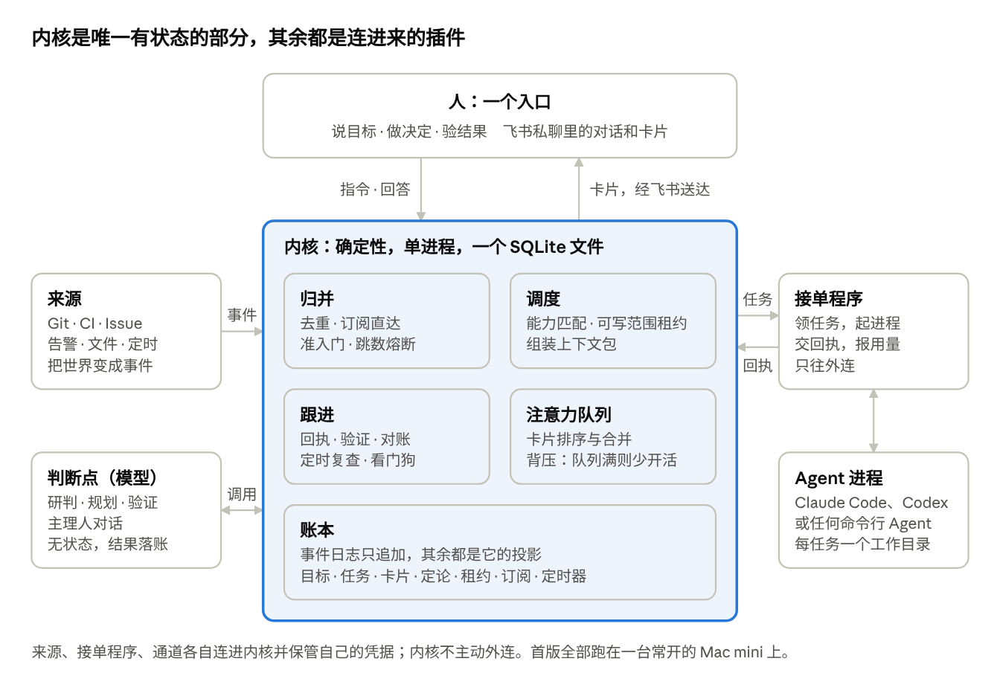
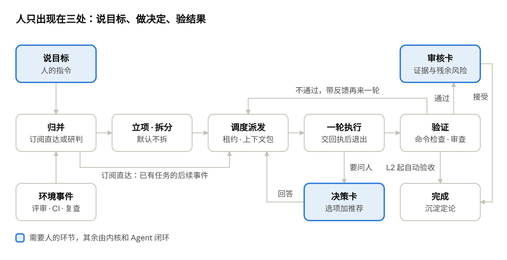

# 璇玑 Xuanji

一个人通过一个入口提目标、做决定、验结果；其余的记账、派活、跟进交给系统。

璇玑是一个多 Agent 协调内核。你说一句话，它整理成目标卡请你确认。确认后，它把活派给本机已登录的命令行 Agent（目前是 Claude Code），一路跟进到验收。只有需要你拍板或审核的时候，才发一张卡片给你。你不用守着任何一个 Agent 会话。

> **状态：一期，实验性。** 作者自用，跑在一台常开的 Mac mini 上，入口是飞书私聊。目前只接了 Claude Code，任务按顺序执行，还不并行。代码可以读、可以跑，但接口和账本格式随时会变。

## 为什么做

多 Agent 并行的瓶颈不在模型，在人的注意力。同时开几个 Agent 会话时，人身兼三职：

- **消息总线**：在会话之间转述背景。
- **时钟**：隔一会儿去看看、催一催。
- **状态库**：记住谁在做什么、做到哪了。

璇玑把这三件事交给一个确定性内核，人只保留意图和判断。

| 设计 | 替人省掉什么 |
| --- | --- |
| 工作的单位是“事”，不是“会话”。背景、决定、进度都挂在目标和任务上 | 切换会话、重复交代背景 |
| 一切皆事件，记在一本只追加的账里。人的指令和环境变化走同一条路 | 手动把外部变化转告给 Agent |
| 确定性内核负责推进，模型只在研判、规划、验证、对话四个判断点被调用 | 催进度、记状态 |
| 权限只来自人。外部文字是资料，不是指令 | 担心外部内容指挥 Agent |
| 一轮不等人。要问人就结束这一轮，答复到了再接上，等待期间零消耗 | 守着终端等它提问 |
| 所有打扰进同一个卡片队列，队列满了就少开新活 | 被几十条推送淹没 |

## 怎么工作



内核是唯一有状态的部分，三类插件连进来：

- **来源**：把世界变成事件。一期只有定时器。
- **接单程序**：把任务变成 Agent 进程。每轮起一个本机命令行 Agent，提示词进去，最后一条消息（回执）出来。
- **通道**：把卡片送到人面前。有飞书私聊和命令行 `xj` 两个。

存储是一个 SQLite 文件。事件表只追加；目标、任务、卡片、租约等都是从事件算出的投影，和事件在同一事务里写入。任何一步为什么发生，都可以用 `xj why <编号>` 从账里查出来。

内核本身不读时钟、不取随机数、不主动连外部，所以可以确定性地重放和测试。内核里也没有模型 API 客户端，判断点同样经接单程序调用本机已登录的 Agent，只是不给工具权限。



完整设计见 [璇玑设计文档.md](璇玑设计文档.md)。

## 一期做到了什么

- 飞书私聊说目标，主理人整理成目标卡（目标、验收、边界、授权），你确认、修改或放弃。
- Claude Code 无界面执行，要问人时结束这一轮，出决策卡；你答了再从原会话接上。
- 看门狗靠心跳发现卡住的轮次。内核或接单程序重启后，从账本恢复，中断的轮次带恢复说明重新派发。
- 对外动作（push、开 PR）先落账再执行：Agent 只在回执里声明，由接单程序检查远端后执行，失败退避重试，不会重复执行。
- 审核卡等对外动作都做完才出；背压上限 5 张卡片；每日 09:00 出简报，简报兼作“系统还活着”的心跳。
- 撤回、收起的卡片，以及在 `xj` 里回答过的卡片，飞书上会自动改成结论；Agent 自己建的 git worktree 列在审核卡上，任务结束后清理，有未提交改动的不删。
- 订阅额度读数与预算上限：自动化默认不超过周限额的 80%。
- 账本每小时一份快照，每周一次恢复演练。
- 三个进程装成 launchd 用户服务，随登录拉起，崩了自动重启。

还没做的事见 [docs/BACKLOG.md](docs/BACKLOG.md)。二期计划引入并行和 Codex，Codex 做独立验证者。

## 环境要求

- macOS（部署脚本用 launchd；内核和测试本身不依赖 macOS）
- Node.js 24 及以上：直接运行 `.ts` 文件，不需要构建
- [Claude Code](https://docs.claude.com/en/docs/claude-code) 命令行，已登录。璇玑走你自己的订阅，不读取、不保存、不转发登录凭据
- git
- 用飞书通道的话，还需要官方 [lark-cli](https://github.com/larksuite/cli)（npm 包 `@larksuite/cli`），以及一个你自己建的飞书应用

运行时零依赖。`typescript` 和 `@types/node` 只用于类型检查。

## 快速开始

```sh
git clone https://github.com/luzhengli/Xuanji.git && cd Xuanji
npm install                 # 只装开发依赖，用于类型检查
npm test                    # 全部用例离线运行，不调用任何 Agent

cp xuanji.config.example.json xuanji.config.json
# 编辑 xuanji.config.json，至少填 owner_open_id（只用命令行的话可以先不填）
```

开三个终端，依次起内核、接单程序和飞书通道：

```sh
npm run kernel                          # 内核，只听 127.0.0.1:7331
XJ_WORK_ROOT=~/xj-work npm run worker   # 接单程序，Agent 在这个目录里干活
npm run feishu                          # 飞书通道（可选）
```

`XJ_WORK_ROOT` 指向一个 git 仓库，Agent 会在里面改代码。先拿一个练手的仓库试。

然后用命令行说一个目标：

```sh
node src/channels/cli/xj.ts goal "给 math.mjs 加一个 cube 函数，带测试"
node src/channels/cli/xj.ts cards                 # 看主理人整理好的目标卡
node src/channels/cli/xj.ts answer C-1 confirm    # 确认，开工
node src/channels/cli/xj.ts status                # 看进度
```

可以设个别名 `alias xj="node $PWD/src/channels/cli/xj.ts"`，下文都写成 `xj`。

## 配置

`xuanji.config.json` 不入库。不写的字段用默认值，见 [src/shared/config.ts](src/shared/config.ts)。

```json
{
  "db": "./data/xuanji.db",
  "port": 7331,
  "owner_open_id": "ou_xxx",
  "backup_dir": "./data/backups",
  "brief_at": "09:00",
  "limits": { "backpressure_cards": 5, "weekly_quota_ratio": 0.8, "per_goal_concurrency": 2, "hop_limit": 8 },
  "agents": {
    "claude": { "use": "claude", "kinds": ["code", "plan", "write", "judge"], "tier": "strong", "billing": "subscription", "capacity": 2 }
  }
}
```

| 字段 | 含义 |
| --- | --- |
| `db` | 账本 SQLite 文件 |
| `port` | 内核端口，只听本机 |
| `owner_open_id` | 你本人在飞书应用下的 open_id。通道只认这一个人的消息和点击 |
| `backup_dir` | 快照目录 |
| `brief_at` | 每日简报的本机时间 |
| `limits.backpressure_cards` | 待处理的决策卡和审核卡上限，到了就不开新活 |
| `limits.weekly_quota_ratio` | 自动化最多用到订阅周限额的多少 |
| `limits.hop_limit` | 跳数熔断，防止事件互相触发停不下来 |
| `agents` | Agent 档案：能做哪类活、强弱档、计费方式、同时几个 |

环境变量：

| 变量 | 用途 |
| --- | --- |
| `XJ_CONFIG` | 配置文件路径，默认 `xuanji.config.json` |
| `XJ_WORK_ROOT` | 接单程序的工作目录 |
| `XJ_WORKER_NAME` | 接单程序名，默认 `local`。同名新实例启动即接管旧实例 |
| `XJ_RECORD_DIR` | 设了就把 Agent 或飞书的原始输出存下来，作测试录制件 |
| `XJ_BACKUP_MS` | 自动备份间隔；测试和临时账本设 `0` 关掉 |

## 飞书通道

1. 用你的个人账号在飞书开放平台建一个企业自建应用，加机器人能力，开通收发消息所需的权限，发布版本。也可以用 `lark-cli config init --new` 扫码建。
2. 在事件订阅里选**长连接**，订阅接收消息和卡片回传交互。不需要公网地址。
3. 把你的 open_id 填进 `owner_open_id`，起 `npm run feishu`。

一个飞书应用只能有一个卡片监听方，所以通道只在一台机器上跑。

私聊里：

| 你发 | 效果 |
| --- | --- |
| 任意一句话 | 主理人整理成目标卡请你确认；如果和在途目标相关，就并入那个目标 |
| `/card`、“卡片”、“待办” | 把待处理的决策卡和审核卡发来，在卡片上直接回答 |
| `/status`、“状态”、“进度” | 看全局 |
| `/brief`、“简报” | 现在出一份简报 |
| `/stop T-x` | 停一个任务 |
| `/help` | 用法 |

飞书不可用时，卡片都还在账本里，用 `xj` 照常查看和回答。

## 命令行 xj

```text
xj goal "<一句话目标>"        说目标，主理人整理成目标卡
xj goal --direct "<一句话>"   跳过主理人，直接立项
xj status                     目标和任务按“在等谁”分组，卡片队列，额度读数
xj cards                      待处理卡片
xj answer <C-x> <选项> [说明] [--scope task|goal|project|global]
xj stop <T-x>                 停一个任务
xj why <编号> [--all]         事件时间线
xj brief                      现在出一份简报
加 --json 输出原始数据
```

## 部署到常开的 Mac

```sh
node scripts/launchd.ts render  --work-root ~/xj-work   # 生成 plist 到 data/launchd/，只看不装
node scripts/launchd.ts install --work-root ~/xj-work   # 装进 ~/Library/LaunchAgents 并启动
node scripts/launchd.ts status
node scripts/launchd.ts uninstall
```

安装脚本会把 `node`、`claude`、`lark-cli`、`git` 所在目录写进服务的 PATH，日志在 `data/logs/`，超过 10 MB 轮转。

机器上还要做两件事：关闭自动睡眠，打开断电后自动开机。服务以登录用户身份运行，这样 Agent 才能用上已有的登录态；整机重启后需要登录一次。

改代码后先重启内核，再重启接单程序：

```sh
launchctl kickstart -k gui/$(id -u)/com.xuanji.kernel
launchctl kickstart -k gui/$(id -u)/com.xuanji.worker
```

## 备份与恢复

内核每小时给账本拍一份快照，每周做一次恢复演练，失败会出卡片。手动操作：

```sh
npm run backup               # 拍一份快照
npm run backup -- --drill    # 拍一份并强制演练
npm run restore              # 列出可用快照
npm run restore -- <快照文件> # 换上这份快照，只在内核停着时做
```

快照默认放在 `data/backups/`，和账本在同一块盘上。重要数据请自己再做异地备份。

## 安全

- 默认自主级别 L1：不可逆或对外的动作，始终先问人。
- 对外动作只能由接单程序执行。执行轮用 `--disallowedTools` 禁掉 `git push`、`gh pr create` 等命令，分支名必须带任务编号，不强推。
- 用哪个 Agent、在哪个目录、什么权限，只由规则和目标决定，不由外部文字决定。
- 内核只听 `127.0.0.1`，没有鉴权。不要把端口暴露到本机以外。
- Agent 在 `XJ_WORK_ROOT` 里有写权限，并沿用你本机 Claude Code 的权限设置。请用你信得过的仓库，并看清它的权限模式。

## 开发

```sh
npm test            # node --test，全部离线
npm run typecheck   # tsc --noEmit
```

Node 24 以 strip-only 模式直接运行 `.ts`，所以不能用构造器参数属性、`enum`、`namespace`。

`test/fixtures/` 里是实测录下的 Claude Code 和飞书原始输出，测试用它们回放，不调用真实 Agent。

```text
src/kernel/     内核：事件日志、投影、归并、调度、注意力队列、本机接口
src/worker/     接单程序、Agent 适配器（adapters/claude-code.ts）、上下文包、对外动作
src/channels/   飞书通道（lark-cli 长连接）和命令行 xj
src/sources/    来源插件（一期只有定时器）
src/ops/        备份、日志轮转
scripts/        备份、恢复、launchd 安装
deploy/         launchd plist 模板
docs/           状态、待办、决定记录、工作日志
```

想参与的话，先读 [AGENTS.md](AGENTS.md)（也是给 AI 编码 Agent 的入口）和 [docs/STATUS.md](docs/STATUS.md)。设计文档是需求的唯一来源：改设计先改文档，再改代码。

## 致谢

- [agent-autoloop](https://github.com/KKKKhazix/agent-autoloop)：事件溯源、挂起零消耗、指令与数据分离、跳数熔断，以及飞书通道用 lark-cli 长连接的做法。
- DeepSeek Harness 的 [Super-agent 原型](https://github.com/deepseek-ai/dsh-superagent-prototype)：两级准入、不可变授权、订阅直达、观察模式。

## 许可证

[MIT](LICENSE)。
