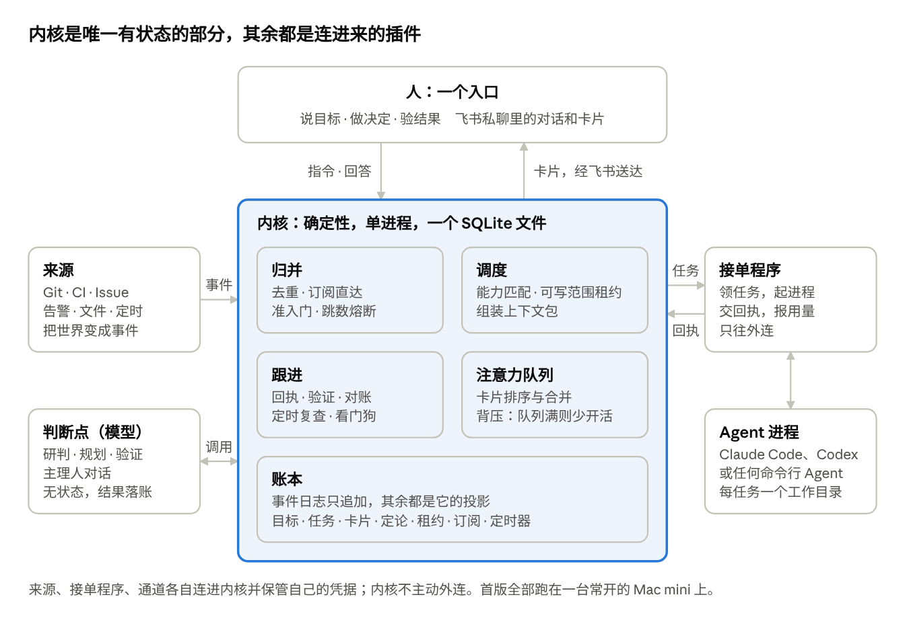
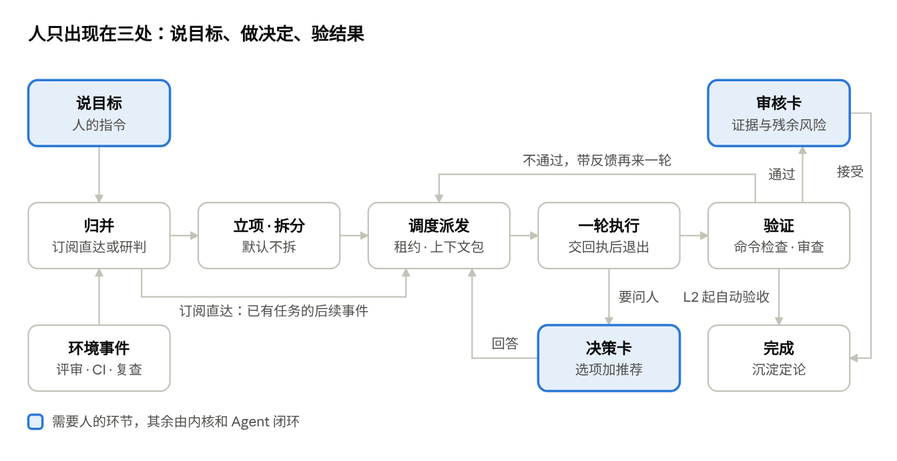
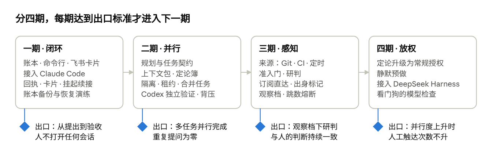

# 璇玑 Xuanji：多 Agent 并行协调系统设计文档

2026-11-10 起草，2026-11-11 按已定事项更新 · lucas li

## 结论

璇玑把“人盯着多个 Agent 会话”换成“人看一个卡片队列”：人只提目标、做决定、验结果，记账、派活、跟进全部交给系统。

多 Agent 并行的上限不在模型，在人的注意力。今天人同时充当消息总线（转述背景）、时钟（催进度）和状态库（记住谁在做什么）。璇玑把这三个角色交给一个确定性内核，只把意图和判断留给人。

| # | 设计决定 | 替人省掉什么 |
| --- | --- | --- |
| 1 | 工作的单位是“事”，不是“会话”。背景、决定、进度都挂在目标和任务上，会话用完即弃 | 切换会话、重复交代背景 |
| 2 | 一切皆事件，记在一本只追加的账里。人的指令和环境变化走同一条路 | 手动把外部变化转告给 Agent |
| 3 | 确定性内核负责记账和推进，模型只在判断点被调用：研判、拆分、验证、对话 | 催进度、记状态 |
| 4 | 权限只来自人。事件携带信息，不携带权限 | 担心外部内容指挥 Agent |
| 5 | 一轮不等人。要问人就结束这一轮，答复到了再接上，等待期间零消耗 | 守着终端等它提问 |
| 6 | 先验证，再给人看。每个任务有验收标准，独立的验证者核对后才生成审核卡 | 审核半成品、亲手跑检查 |
| 7 | 人的注意力是被调度的资源。所有打扰进同一个队列，队列满了就少开新活 | 被几十条推送淹没 |

实现是一个单进程内核加一个 SQLite 文件。执行用现成的命令行 Agent（Claude Code、Codex 等），不重造 Agent。首版只服务一个人，跑在一台常开的 Mac mini 上，入口是飞书私聊。

事件溯源、挂起零消耗、指令数据分离、跳数熔断取自 [agent-autoloop](https://github.com/KKKKhazix/agent-autoloop)。两级准入、不可变授权、订阅直达、观察模式取自 DeepSeek Harness 的 [Super-agent 原型](https://github.com/deepseek-ai/dsh-superagent-prototype)。两者都以“一个事件对应一件活”为中心；璇玑补的是目标层：一个目标拆成多件可独立验收的活，并行执行，验证后汇总给人。

## 已定的事

下面十二条由你在 2026-11-11 定下，适用范围都是本项目。它们按本方案的定论格式记录，后面的设计都以它们为前提。

| 定论 | 你的原话 | 落在方案的哪里 |
| --- | --- | --- |
| 首版单人、单机 | “首版只服务我个人，跑在持续运行的mac mini” | 总体架构的部署一节；飞书通道只认你本人；不做准入表 |
| 首个通道是飞书 | “通道首选飞书” | 入口一节的飞书通道；一期就接飞书卡片 |
| 默认自主级别 L1 | “默认L1自主级别” | 安全一节；每个结果都由你验收 |
| 自建内核 | “自建内核” | 落地路线；不在现成中台上外挂 |
| 背压上限 5 张 | “背压上限默认 5 张卡片” | 入口一节的注意力调度 |
| 飞书用个人账号 | “我有一个个人飞书账号”；“我问了下飞书自带的豆包工作说可以。” | 入口一节的飞书通道；在开发者后台建企业自建应用 |
| 备份优先，先不做重启自动登录 | “暂时先不考虑重启自动登录，做好备份更重要。” | 总体架构的备份与恢复；重启后由你登录一次 |
| Agent 接入顺序 | “首个接入Claude code，后续接入Codex、DeepSeek Harness。” | 分派一节的 Agent 档案；落地路线 |
| 订阅为主，API 只用于 DeepSeek Harness | “目前本地Claude Code和Codex是订阅，API烧不起；DeepSeek Harness是 API。” | 分派一节的额度与计费；预算单位 |
| 首版不做异地备份 | “先不做异地备份，后续在做” | 总体架构的备份与恢复；风险表 |
| 快照先放系统盘 | “快照就放在当前系统盘……后续我再加独立盘。” | 总体架构的备份与恢复；先把备份功能验证通过 |
| 自动化用量不超过订阅周限额的 80% | “初步定在订阅的周限的60%以内，后续可调整”；2026-11-12 改为：“60%周限限制点改为80%吧” | 分派一节的额度与计费 |

## 第一性原理：人的注意力花在了哪里

出发点是一个约束：Agent 可以横向复制，人的注意力不能。DeepSeek Harness 的文章给出的经验是：一个人通常只能同时跟进 3 到 5 个活跃会话，单任务的上限取决于模型能力，多任务的上限取决于人的注意力。所以要优化的量不是 Agent 的数量，而是每交付一件事消耗多少人的注意力。

把人在多会话工作里做的事逐项拆开：

| 人在做什么 | 实质角色 | 为什么落在人身上 | 能否交给系统 |
| --- | --- | --- | --- |
| 决定找哪个会话、要不要开新会话 | 路由器 | 没有统一的入口和派发 | 能 |
| 向每个会话重讲背景和已定的事 | 消息总线 | 背景锁在各自会话里，人是唯一的共享记忆 | 能 |
| 轮流查看谁做完了、谁卡住了 | 监控 | 会话不会主动报告状态 | 能 |
| 说“继续”“跑一下测试”“再改改” | 时钟 | 会话一轮结束就停，没有东西再唤醒它 | 能 |
| 记住哪些事在途、各自在等什么 | 状态库 | 状态不在任何持久的地方 | 能 |
| 把 CI 结果、评审意见转告 Agent | 传感器 | 环境变化到不了会话 | 能 |
| 合并并行产出、处理冲突 | 集成者 | 并行任务之间没有边界约定 | 大部分能 |
| 检查结果对不对 | 验证者 | 没有独立的验证环节 | 大部分能 |
| 定目标、做取舍、承担后果 | 意图和判断的来源 | 这些信息只在人脑里 | 不能，也不应该 |

前八项里人没有提供任何新信息，只是在充当基础设施。只有最后一项是人独有的。由此得到五条推论。

1. **人提供的每一条信息只应提供一次。** 目标、约束、决定必须落在持久的地方，并自动带给之后所有相关的工作。重复交代背景说明信息存错了地方：存在了会话里，而不是事上。
2. **状态必须在会话之外。** 会话有上下文上限，会崩溃，会被关掉。状态放在会话里，人就得记住哪个会话是哪件事。状态放进账本后，任何 Agent 都能从记录接手，会话变成可丢弃的执行容器。DeepSeek 原文的说法是：Session 应当是系统的实现细节，而不应是用户的认知负担。
3. **推进由状态差驱动，不由人驱动。** 会话停下来是因为没有东西再调用它。给每件事写明做成什么样算完，系统就能反复比较现状与目标，有差距就继续派活。这与 Kubernetes 的调谐循环同理：人声明期望状态，控制器负责收敛。
4. **协调靠共享状态，不靠互相通信。** n 个 Agent 两两沟通，通道数按 n² 增长，内容也无法审计。所有 Agent 只读写同一本账，成本按 n 增长，人看到的也是同一本账。
5. **只在人的信息值得时才打扰人。** 一次打扰的成本是注意力切换，收益是只有人知道的信息。可逆、影响小的事不值得问。不可逆、对外、花钱、改方向的事值得问，并且要做成带推荐项的选择题，让回答成本降到一次点击。

还有两条约束来自 Agent 自身的特性。

- **不照搬人类组织。** 层级、例会、汇报是为人的局限设计的：注意力有限，记忆持久但沟通带宽窄。Agent 的局限不同：上下文有限，没有跨会话记忆，复制成本近于零。给它的应该是新鲜上下文、明确契约和共享账本，不是“经理 Agent 管工程师 Agent”。
- **按耦合度切分。** 紧耦合的步骤放在一个 Agent 的上下文里，协调成本最低。松耦合、可独立验收的交付物才值得拆到系统层并行。拆得过细，集成成本会吃掉并行收益。

## 目标、非目标与衡量指标

目标是在人只看一个入口的前提下，让同时推进的事远超 3 到 5 件，并且每件事的人工触达次数不随并行度上升。

**目标**

- 一个入口。人不打开任何 Agent 会话，也能完成提目标、做决定、验结果。
- 两类触发。人的指令和环境变化都能立项，走同一套流程。
- 背景只说一次。已定的事不再问第二遍。
- 自动推进到验收。除了决策和验收，人不需要说“继续”。
- 轻。一台常开的 Mac mini、一个进程、一个数据库文件，不依赖消息队列、向量库或云服务。

**非目标**

- 不造新的 Agent 或模型封装。执行交给现成的命令行 Agent。
- 不做 Agent 之间的自由对话，也不做角色扮演式的组织。
- 首版只服务一个人，不做多人团队的身份与准入体系。
- 不追求全自动。不可逆和对外的动作默认由人确认。
- 不做通用工作流编排器。流程由目标和验收标准驱动，不靠人画流程图。

**指标**

| 指标 | 定义 | 目标方向 |
| --- | --- | --- |
| 每件交付的人工触达次数（北极星） | 从立项到验收，人发消息和回答卡片的次数 | 常规任务不超过 2 次：提出 1 次，验收 1 次 |
| 重复提问率 | 定论簿里已有答案却再次问人的卡片占比 | 趋近 0 |
| 人工催办次数 | 人主动问进度或说“继续”的次数 | 趋近 0 |
| 一次验收通过率 | 审核卡首次即被接受的占比 | 上升；下降时收紧验证或降低自主级别 |
| 等人时间占比 | 任务周期中处于“等人”状态的时间占比 | 下降 |
| 有效并行度 | 同时处于执行中的任务数 | 上升，受卡片队列长度约束 |
| 误接单率 | 环境触发的任务中被人撤销的占比 | 先在观察档测量，达标再放开 |

## 核心概念

全系统只有七个名词。新需求优先做成它们的属性，不加新概念。

| 概念 | 是什么 | 它守的规则 |
| --- | --- | --- |
| 事件 Event | 发生了一件事：人发来消息、CI 变红、时间到了、Agent 交了回执、人点了卡片 | 不可变，可去重。只携带信息，不携带权限 |
| 目标 Goal | 人要的结果，加上验收标准、边界和授权 | 只有人或人写的规则能立目标。授权在立项时定下：自主级别、可写范围、预算、必须先问的事 |
| 任务 Task | 目标下一个可独立验收的交付物 | 带一份契约：做什么、怎么算完、能写哪里、预算多少、依赖谁。状态按“在等谁”定义 |
| 一轮 Run | 一个 Agent 对一个任务的一次执行 | 用完即弃，结束时必须交回执。一个任务可以有多轮，可以换 Agent |
| 回执 Receipt | Agent 最后一条消息里的结构化部分 | 系统与 Agent 之间唯一的约定：结果与证据、交接说明、要问人的问题、约定的复查、发现的范围外事项 |
| 卡片 Card | 给人看的东西 | 只有三种：决策、审核、知会。人的回答本身是一条事件 |
| 定论 Ruling | 人做过的决定和长期偏好，包括“定了不做”的事 | 带适用范围：全局、项目、目标。自动注入之后相关任务的上下文，可升级为常规授权 |

四个辅助机制不算概念。规则决定哪些环境事件可以立项。订阅记录任务关心哪些外部对象。租约记录任务占用哪些可写范围。上下文包是派发时现组装的投影，不单独存储。

任务的状态只回答一个问题：它在等谁。四类互斥且覆盖全部情况。

| 在等谁 | 状态 | 消耗 |
| --- | --- | --- |
| 等人 | 待答复、待审核、受阻 | 无进程，无 Token |
| 等 Agent | 排队、执行中、验证中 | 占一个并发名额 |
| 等世界 | 等外部事件（CI、评审、定时复查）、等依赖的任务 | 无进程，无 Token |
| 不再等 | 完成、放弃、被人停止 | 无 |

## 总体架构

内核是唯一有状态的部分。来源把世界变成事件，接单程序把任务变成 Agent 进程，通道把卡片送到人面前，三者都是连进来的插件。



内核的四个模块对应一件事的四个阶段：归并决定事件去向，调度决定谁来做，跟进推到验收，注意力队列决定何时打扰人。

三条结构性约束：

- **内核不用模型做控制流。** 研判、规划、验证、主理人对话是四个无状态的模型调用，输入输出都落账。换模型不影响状态。
- **内核不主动连接外部。** 来源、接单程序、通道各自连进来，并保管自己的凭据。内核不读时钟、不取随机数，因此可以确定性地重放和测试。接单程序可以与内核同机，也可以在另一台机器上。
- **主理人不保存状态。** 它是入口处与人对话的模型，每次从账本取当前态势作答。会话丢了可以重建。

存储是一个 SQLite 文件。事件表只追加。目标、任务、卡片、定论、租约、订阅、定时器都是从事件算出的投影，与事件在同一事务写入。任何一步为什么发生，都能用一条命令从账里查出来。

### 一件事怎么走完



被退回的审核卡与验证不通过走同一条回路：带着意见回到调度，再来一轮。等外部结果的任务不占进程，事件到达后经订阅直达继续。

### 部署：一台常开的 Mac mini

首版的内核、接单程序、飞书通道和所有 Agent 都跑在同一台 Mac mini 上。它不需要公网地址，也不上云。

| 部件 | 怎么跑 | 停了怎么办 |
| --- | --- | --- |
| 内核 | 一个常驻进程，只听本机端口 | 由 launchd 拉起；重启后从账本重建状态 |
| 接单程序 | 同机进程，连本机内核 | 由 launchd 拉起；中断的轮次带恢复说明重新派发 |
| 飞书通道 | 同机进程，靠官方 lark-cli 的长连接收消息和卡片点击 | 断线自动重连；期间的卡片留在账本里，连上后补发 |
| Agent | 已登录的命令行 Agent，每轮起一个进程 | 用完即退，不常驻 |
| 环境来源 | 轮询或长连接，不依赖公网回调 | 各自保存读位置，停机期间的变化恢复后补读 |
| 账本 | 一个 SQLite 文件 | 每小时一份快照，见下一小节 |

你在手机或别的电脑上只用飞书。要看全局或排查，ssh 到 Mac mini 上运行 `xj`。

机器本身要做两件事：关闭自动睡眠，打开断电后自动开机。内核和接单程序以登录用户的身份运行，这样 Agent 才能用到已有的登录态。

三个进程装成用户级的 launchd 服务（`com.xuanji.kernel`、`com.xuanji.worker`、`com.xuanji.feishu`），随登录拉起，崩了自动重启。安装用 `node scripts/launchd.ts install`，它把 deploy/ 里的模板填上 node 路径和含 `claude`、`lark-cli` 的 PATH；接单程序名固定为 `local`，一期的工作目录是 `~/xj-work`（2026-11-12 人定）。

首版不做开机自动登录。重启后需要你登录一次，登录后各进程自动拉起，从账本续做；停机期间的飞书消息和环境变化由来源补读。停机时系统发不出通知，所以每日简报兼作心跳：到点没收到简报，就说明它停了。

### 备份与恢复

要备份的只有四样，其余的可以重建或重新签发。下表的频率和保留份数是默认值，可以调。

| 对象 | 丢了的后果 | 怎么备份 |
| --- | --- | --- |
| 账本 | 目标、任务、定论和全部历史都没了 | 每小时用 SQLite 的在线备份生成一份一致的快照，先写到系统盘上的备份目录，保留 48 份。加了独立盘后改写到那块盘 |
| 规则、Agent 档案、Skill | 系统不知道该接什么活、怎么做 | 放在一个 git 仓库里，每次改动都提交并推到私有远端 |
| 任务的工作成果 | 最近一轮的改动丢失 | 每轮结束时提交到任务分支并推到远端。非代码产出放进产出目录，随账本快照一起备份 |
| 定论簿的可读副本 | 不影响运行，但你没法直接翻看 | 每天从账本导出成 Markdown，放进上面那个 git 仓库 |

首版的快照和账本在同一块系统盘上，也不做异地备份。这一步的目的是先把备份、告警和恢复演练的功能验证通过。在加独立盘之前，它能防数据库损坏和误操作，防不了盘坏、失窃或火灾，那时账本无法恢复。规则、Skill 和任务成果推到了 git 远端，不受影响。

三样东西不备份：

- **Agent 会话。** 每轮都有交接说明，会话本来就是用完即弃的。
- **投影。** 可以从事件日志重建。
- **密钥。** 飞书应用凭据和 API Key 都能重新签发，不进备份。恢复清单里列明要重新签发哪几样。

三条规则让备份可信：

- **不直接拷贝正在写的数据库文件。** 文件级拷贝可能拿到写了一半的状态。快照一律由 SQLite 的在线备份生成，再交给同步或上传工具。
- **备份失败要告诉你。** 最近一次成功备份的时间显示在 `xj status` 里。超过阈值没有成功，就出一张异常卡。
- **定期演练恢复。** 每周自动把最新快照恢复到临时目录，做完整性检查，再从事件日志重建投影，与快照里的投影比对。没演练过的备份不算备份。

一期的做法：备份来源跑在内核进程里，和定时器来源一样把结果报成事件（`backup.done`、`backup.failed`、`backup.drilled`）；快照失败、超过 3 小时没有成功、演练没通过，都出一张推送的异常卡，恢复正常后撤回。演练没通过时每次备份后再演练，直到通过。手动备份和恢复用 `npm run backup [-- --drill]`、`npm run restore <快照>`，后者只在内核停着时动手，原账本挪到一旁不删。

恢复分四步：

1. 停内核，换上快照，重新签发密钥，启动。
2. 内核从账本重建状态，把快照里标为执行中的轮次带恢复说明重新派发。
3. 来源从快照里的读位置开始补读。快照之后发生的外部变化重新入账，重复的按编号去重。
4. 系统在快照之后做过的对外动作靠出身标记认回来。分支名、提交尾注、PR 描述里都有任务编号，Agent 在重复任何对外动作之前先查远端。

按每小时快照算，最多丢一小时内你在卡片上的回答和 Agent 的回执。丢失的回答表现为卡片变回待处理，再答一次即可。

## 触发：人的指令和环境变化走同一条路

所有输入先变成事件，再经四步决定去向。前三步是代码，只有第四步调用模型。

1. **去重与合并。** 同一来源同一编号只记一次。同一任务排队期间到达的多条事件合并成一轮处理。
2. **订阅直达。** 事件所属的外部对象（PR、Issue、CI 运行、对话线程）已被某个任务订阅时，直接作为上下文送达该任务，不再研判。任务自己创建的对象自动订阅。订阅是多对多的：几个任务关心同一个对象时，事件同时送达各方，冲突由各方自己发现。
3. **准入门。** 没有订阅者的事件先过确定性检查。人在入口直接说的话是明确请求。环境事件必须匹配一条人写的规则，否则只记录。
4. **研判。** 通过准入的候选交给模型，对照规则和在途任务判断：立新目标、并入已有任务，还是忽略。研判没有工具权限，只输出结构化结论和理由。

订阅直达是环境变化能自动归位的关键，DeepSeek 原文称之为“订阅与直通”。在它的合成负载测试里，去掉这一步后 Router 要做的决定多约 30%，读缓存 token 多约 37%。

环境规则有三档，从窄到宽逐步放开：

| 档位 | 行为 | 用途 |
| --- | --- | --- |
| 观察 | 只记录“本来会接”，不执行 | 新规则的默认档，用来校准研判 |
| 静默预做 | 在只读或可逆的范围内先做，结果有用才出卡片，否则丢弃 | 复现报错、起草回复、预研方案 |
| 自动 | 按规则的授权直接立项执行 | 已验证稳定的常规工作 |

一条规则写明什么事件、立什么目标、给多大授权（示例）：

```yaml
- name: 主干 CI 变红
  when: { source: github, types: [ci.failed], branch: main }
  mode: speculative            # observe | speculative | auto
  goal: 定位并修复导致主干失败的提交
  grant: { level: L1, effects: [push-branch, open-pr], budget: { runs: 4, minutes: 60 } }
  ask_first: [回滚他人的提交]
```

两条防线防止事件风暴：

- **跳数熔断。** Agent 产生的事件再触发 Agent 时层数累加，经过人工回答和定时复查也不清零。超过上限（agent-autoloop 取 8）就只记录，并出一张卡片。
- **人优先。** 并发名额为人的消息预留一个，新活不能挡住人继续一件已有的事。

## 上下文：背景跟着事走

背景存在目标和任务上。每一轮开始时，内核现组装一个上下文包交给 Agent，人不参与。

关联靠三层机制，便宜的先用：

| 层 | 机制 | 解决什么 |
| --- | --- | --- |
| 确定性 | 出身标记：系统产出的分支名、提交尾注、PR 描述都带任务编号 | 环境回流的事件凭编号直接归位，不需要判断 |
| 结构性 | 引用图：目标、任务、轮次、卡片、定论、外部对象各有编号并互相链接 | 从任一对象出发，逐跳找回相关背景 |
| 语义性 | 全文检索，只用于没有编号可依的输入，比如人说“登录那件事怎么样了” | 兜底。把握不足时给人候选项，不猜 |

上下文包按“内联与外溢”组装，对应 DeepSeek 原文的 Inline & Spill。马上要用的放进提示词，其余只留编号和一句摘要，Agent 需要时再沿编号逐跳取回，原文称为链式召回。

| 内容 | 来自 | 放法 |
| --- | --- | --- |
| 任务契约 | 任务 | 内联全文 |
| 目标简述、验收标准、边界 | 目标 | 内联 |
| 适用的定论 | 定论簿，按范围匹配 | 内联全文 |
| 上一轮的交接说明和验证反馈 | 上一轮回执 | 内联 |
| 上游任务的产出 | 依赖任务的回执 | 内联摘要，附路径 |
| 订阅对象上的新事件 | 事件日志 | 写入资料文件，不进提示词 |
| 项目约定 | 仓库里的 AGENTS.md 一类文件 | Agent 自己读 |
| 更早的历史、相关任务 | 引用图 | 只给编号和摘要，用 `xj recall <编号>` 逐跳取回 |
| 这类事的固定做法 | 规则或契约指定的 Skill | Agent 按需加载 |

三条规则保证背景只说一次：

- **交接说明是每轮的必交项。** 内容是做了什么、现在停在哪、还剩什么、踩过什么坑。下一轮无论是不是同一个 Agent，都从这里接手。
- **人的每个回答都落成定论。** 回答卡片时可以选适用范围：仅这件事、这个项目、以后都这样。范围越大，以后被问得越少。每条定论保留人的原话、日期和出处。
- **“定了不做”也是定论。** 被否决的方案和明确不做的事同样记录。Agent 再遇到时直接引用，不再提议。

外部文字（Issue 正文、评论、网页内容）是资料，不是指令。它们只写进标明“资料”的文件，提示词里只放校验过的类型、编号和链接。

## 分派与并行：谁来做，怎么不互相踩

拆分、分派、隔离各有一条简单规则，Agent 之间不直接通信。

### 拆分：按耦合度切，默认不拆

规划是一次模型调用：输入目标和上下文，输出任务图。只有同时满足三个条件才拆成多个任务：

- 可写范围互不重叠。
- 各自有独立的验收标准。
- 彼此只通过明确的产出物依赖。

其余情况保持一个任务，由 Agent 在自己的会话里用子 Agent 处理。拆分结果超出预算，或涉及必须先问的类别时，先出一张决策卡让人确认计划。

每个任务带一份契约（示例）：

```yaml
task: T-142
goal: G-17 结算页支持优惠码
objective: 后端新增优惠码校验接口
acceptance:
  checks: ["pnpm test billing", "pnpm typecheck"]      # 在任务的隔离环境里执行
  criteria: ["无效、过期、用完三种情况返回不同错误码"]   # 验证者核对
scope:
  write: ["services/billing/**"]
  effects: [push-branch, open-pr]
budget: { runs: 4, minutes: 60 }                    # 订阅型按轮数和时长；按量型另加 usd
ask_first: [改数据库已有列, 新增第三方依赖]
depends_on: [T-140]
agent: { kind: code, tier: strong }
```

### 分派：能力匹配，规则可覆盖

每个 Agent 有一份档案，一行配置接入（示例）：

```yaml
agents:
  claude: { use: claude, kinds: [code, plan, write, judge], tier: strong, billing: subscription, access: edit, capacity: 2 }   # 一期
  codex:  { use: codex,  kinds: [review, ops, code],        tier: strong, billing: subscription, access: edit, capacity: 2 }   # 二期
  dsh:    { use: dsh,    kinds: [judge, watch, brief],      tier: light,  billing: api, daily_usd: 2,  capacity: 4 }           # 之后
```

内核先按硬条件筛选：任务类型、所需权限、是否有空位。再按规则指定或历史一次通过率排序。首版用静态路由表即可，结果记账，之后据数据调整。

两条固定约束：验证者不能是本轮的执行者；做判断和验收的模型档位不低于被它检查的执行者。

固定做法沉淀为 Skill。规则和任务契约可以指定一个 Skill，也就是写给 Agent 的操作规程。要改做法只改 Skill，不动规则和内核。

### 额度与计费：订阅是主力，按量计费只做便宜的事

Claude Code 和 Codex 走订阅，DeepSeek Harness 走 API。两种计费下稀缺的东西不同，调度规则也不同。

| | 订阅型：Claude Code、Codex | 按量型：DeepSeek Harness |
| --- | --- | --- |
| 稀缺的是什么 | 额度窗口。用到上限就限流，到点重置 | 钱。每个 token 都计费 |
| 预算单位 | 轮数、时长，以及自动化每周的用量上限 | 费用，按天和按目标设上限 |
| 适合的工作 | 执行、规划、验证这类重活 | 研判、看门狗检查、简报这类量大而输出短的判断 |
| 用尽时 | 任务转入“等世界”，到额度重置时间再跑。不算失败，也不打扰人 | 超限即停，出一张卡片 |

四条规则：

- **判断点也是一轮。** 研判、规划、验证、主理人对话都经接单程序调用已接入的 Agent，只是不给工具权限。内核里没有任何模型 API 客户端。DeepSeek Harness 接入前，判断点由 Claude Code 承担；接入后，量大的研判和看门狗检查转给它。
- **给你自己留额度。** 你日常也在用同一份订阅。本周用量读数达到周限额的 80% 时（最初定 60%，2026-11-12 人改为 80%），自动化不再开新活，本周内只跑你亲自提出的目标；这个比例以后可调。读数是整个账号的周用量，包含你自己的使用。Claude Code 的读数来自无界面运行时 `--output-format stream-json` 事件流里的 `rate_limit_event`：`rate_limit_info.unifiedWindows.seven_day` 给出 `utilization` 和 `resetsAt`，每一轮都会刷新一次，接单程序把它作为 `quota.observed` 事件记进账本（2026-11-11 实测，Claude Code 2.1.322；状态栏脚本在无界面模式下不会被调用，所以不走那条路）。Codex 的读法还没核实，读不到时按回执里的用量累计。
- **按来源排优先级。** 额度紧张时的顺序是：你提出的目标，环境触发的任务，静默预做。静默预做最先暂停。
- **谁做什么看数据。** DeepSeek Harness 是否也承担执行任务，接入后看它的一次验收通过率再定。

### 隔离：每个任务一个工作目录，可写范围先登记再动手

- 代码任务各用一个 git worktree 和一条分支，互相看不到未提交的改动。二期之前所有任务共用一个工作目录；Agent 自己建的 worktree（路径或分支名带任务编号）由接单程序每轮结束后查出来随回执上报，审核卡上列出，任务结束后系统清理。有未提交改动的不删，出一张知会卡；分支始终留着（P1-28）。
- 任务契约声明可写范围。调度时在账本里登记租约，范围重叠的任务不同时执行。
- 独占资源（预发环境、数据库迁移、发布通道）作为具名租约，同一时刻只给一个任务。
- 合并是一个单独的任务，在它依赖的任务都通过验证后执行。冲突由它带着双方的交接说明解决，解决不了就出决策卡。

一个任务需要另一个任务的信息时，读对方的回执。需要对方改动时，在自己的回执里写“发现的范围外事项”，由内核送去研判。

### 并发的三道上限

1. 接单程序的容量：这台机器同时能跑几个 Agent 进程。
2. 每个目标的并发数：防止一个大目标占满全部名额。
3. 注意力背压：待人处理的卡片达到上限时，暂停启动预计会产生新卡片的任务，优先推进能直接收尾的任务。

## 跟进：系统自己推进到验收

一轮结束时 Agent 交回执，内核据此决定下一步。人不需要说“继续”。

### 回执

回执写在 Agent 的最后一条消息里。Agent 不需要装任何东西，也不需要连接内核（示例）：

```json
{
  "outcome": "done",
  "summary": "优惠码校验接口已实现，三类错误码都有测试覆盖",
  "evidence": [
    { "check": "pnpm test billing", "result": "42 passed" },
    { "artifact": "pr", "ref": "github:acme/shop#318" }
  ],
  "handoff": "实现在 services/billing/coupon.ts。过期判断用服务器时区，见定论 R-12。未处理并发扣减，已列为范围外事项。",
  "ask": [],
  "later": [{ "on": "github:acme/shop#318 ci.completed", "timeout": "2h", "about": "CI 出结果后核对" }],
  "found": [{ "title": "优惠码并发扣减可能超发", "why": "当前没有行锁" }]
}
```

| 回执 | 内核的动作 |
| --- | --- |
| `done` 做完了 | 进入验证 |
| `waiting` 在等外部 | 按 `later` 登记订阅或定时器，任务转入“等世界”，进程退出 |
| `ask` 非空 | 生成决策卡，任务转入“等人”。回答到达后接上原会话继续 |
| `blocked` 需要人解除 | 生成决策卡，写明卡在哪、恢复后只需做哪些剩余步骤 |
| `failed` 没跑成 | 临时故障退避重试，连续失败转“受阻” |
| `nothing` 无事可做 | 结束，不打扰人 |

回执格式写错时不重做业务，只让 Agent 在原会话里重写最后一条消息。

订阅额度用尽不算失败。接单程序识别到限流后，任务转入“等世界”，定时器设在额度重置时间；拿不到重置时间就退避重试。

### 运行途中的新输入

一轮正在执行时到达的输入，按来源分三种处理。人不需要等这一轮跑完才能说话。

| 输入 | 处理 |
| --- | --- |
| 环境事件（CI、评论） | 排队，合并进下一轮 |
| 人的补充说明 | 排队。本轮回执一到，内核立即带着补充开下一轮 |
| 人说“停”或“改方向” | 内核取消本轮并结束整个进程组，保留工作目录。下一轮从工作目录和 git 状态接手 |

支持中途注入的 Agent 可以在下一步就读到新输入。这是适配器的可选能力，不是内核约定。

### 验证在人之前

验证分两层，便宜的先跑：

1. 契约里的检查命令（测试、类型检查、构建），由接单程序在任务的隔离环境里执行，内核只记结果。Agent 写的代码不在内核进程里跑；需要更强隔离时，每次检查用一个一次性的容器或虚拟机。
2. 独立的验证者对照验收标准审查产出。它只读、不联网、读不到密钥。它只报违反验收标准或会出错的问题，不报风格，最多三轮。

不通过时，验证意见作为反馈开启新一轮。通过后按目标的自主级别，自动验收或生成审核卡。验证者必须列出残余风险，审核卡原样展示。

### 卡住由看门狗发现，不靠人巡视

- **确定性检查。** 心跳超时、单轮超时、预算用尽、同一失败特征连续出现两次、跳数超限。
- **模型检查。** 对长时间运行的任务，定期用一次独立调用对比目标与最近的回执，判断是否空转或偏题。
- **处置阶梯。** 原样重试，换策略或换 Agent 重试，重新规划，最后才出卡片问人。每一级都记账。

### 目标层的对账

每条与目标相关的事件到达时，以及定时心跳时，内核对目标做一次对账：

- 有没有依赖已满足但还没派发的任务。
- 有没有全部任务完成但目标验收还没跑。
- 有没有回执里的范围外事项还没处理。

有差距就补动作。系统因此对漏掉的事件不敏感，下一次对账会补上。

### 重启恢复

内核重启后从账本重建状态。标记为执行中但进程已不在的轮次，带一条恢复说明重新派发：先检查工作目录、git 历史和远端状态，再决定是否重复任何对外动作。对外动作一律先落账后执行，带幂等键重试。

## 入口：人只做三件事

入口是一个对话框加一个卡片队列，二者读写同一本账。人的全部操作归为三个动词：说目标、做决定、验结果。

### 说目标

人用一句话描述要什么。主理人把它整理成目标卡，请人确认（示例）：

```text
目标  结算页支持优惠码
验收  有效码按规则减价；无效、过期、用完分别提示；现有支付测试全绿
边界  不改订单表已有列；不引入新的第三方服务
授权  L1 做到可审核为止 · 预算 8 轮或 2 小时 · 先问：改数据库结构、对外发消息
```

小而明确的请求跳过确认，直接立项。人之后的补充先按订阅送达所属任务；超出原范围时由任务交还，重新研判。

### 做决定、验结果

卡片只有三种。每张自成一体：不用回忆上下文，不用打开会话，就能作答。

| 卡片 | 何时出现 | 内容 | 人的动作 |
| --- | --- | --- | --- |
| 决策卡 | 任务遇到必须先问的事，或缺只有人知道的信息 | 一个问题、为什么现在要定、选项与取舍、推荐项、不答的后果 | 点选或一句话回答，可选适用范围 |
| 审核卡 | 任务通过验证，且自主级别要求人验收 | 要求是什么、交付了什么、证据、残余风险、最值得人看的几处 | 接受、退回并附意见、接管 |
| 知会卡 | 自动完成的事、异常、每日简报 | 一两句话加链接 | 不需要动作 |

一张决策卡只问一个问题。退回的意见是一条事件，任务带着它开始新一轮。卡片正文设长度上限，细节放在链接后的证据里；DeepSeek 在即时通讯里验证过的硬规则是每条回复不超过 100 词。

### 注意力调度

所有卡片进同一个队列，由内核而不是 Agent 决定何时打扰人。

- **排序。** 按挡住了多少在途工作和紧急程度排，不按到达时间。
- **合并。** 同一目标下的多个问题合并展示。同一个问题还开着时不重复发。
- **推送与静默。** 只有阻塞性的决策卡（含目标卡、超预算卡）和异常会推送。审核卡和知会卡留在队列里，随每日简报汇总，汇总过的知会卡随即收起。两种知会卡例外，也推送：每日简报本身（它兼作心跳），以及主理人对人刚说的那句话的答复（直接立项了、或不像目标）（2026-11-12 人认可）。可设免打扰时段。
- **背压。** 待处理的决策卡和审核卡合计达到上限时，暂停启动会产生新卡片的任务。上限默认取 5，即人能同时跟进的会话数的上界。
- **默认与超时。** 可逆的决策可以带默认项和期限，到期按推荐项执行并出知会卡。不可逆的事永不因超时自动执行。

### 看全局

入口默认只回答第一个问题，另外两个按需展开。健康的状态不占地方。

1. 现在有什么需要我？卡片队列。
2. 系统在做什么，健康吗？目标列表，按“在等谁”分组。
3. 这件事的来龙去脉？`xj why <编号>` 列出事件、研判、每一轮、回执、卡片的时间线。连续的心跳默认折成一行“心跳 N 次”，`--all` 全部列出。

入口是协议，不是界面。首版的入口是飞书里你与机器人的私聊。命令行 `xj` 是同一组接口上的第二个客户端，用来看全局和排查。网页看板以后需要时再加。

### 飞书通道

- **发消息就是说目标。** 你在私聊里说一句话，主理人整理成目标卡回给你确认。问进度也在这里问。
- **命令。** `/card`（或“卡片”“待办”）把待处理的决策卡和审核卡发来，可以直接在卡片上回答；`/status`（或“状态”“进度”）看全局；`/brief`（或“简报”）现在就出一份简报；`/stop T-x` 停一个任务；`/help` 看用法。审核卡不主动推送，随简报汇总，也可以用 `/card` 取。私聊里不是命令的话交给主理人整理成目标卡。
- **目标卡。** 目标、验收、边界、授权，另有主理人的提醒（例如要加的东西好像已经有了）。按钮是确认、修改、不做；要改什么写在文字框里再点“修改”，主理人据此重整一张（2026-11-12 人定）。
- **卡片即状态。** 决策卡带选项和推荐项，另有一个文字框，用于选项都不合适的情况。回答后卡片原地改成结论，不能再点。在 `xj` 里回答的、被撤回的、随简报收起的卡片，通道也主动把飞书上那张改成现状，不等人点（2026-11-12 起，P1-27）。
- **只认你本人。** 通道配置里只写你一个回答人，其他人的消息和点击都不算。只在私聊里收发，不进群。
- **不需要公网地址。** 消息和卡片点击经官方 lark-cli 的长连接进来，agent-autoloop 的飞书通道就是这样做的。同一个飞书应用只能有一个卡片监听方，所以只在这台 Mac mini 上跑。
- **用你的个人账号建应用。** 在飞书开放平台的开发者后台扫码登录，创建企业自建应用，填名称、描述和图标，添加机器人能力，开通所需的 API 权限，再创建版本并发布。也可以用 `lark-cli config init --new` 扫码建应用。之后订阅卡片回传交互，并选长连接。
- **飞书不可用时不丢。** 卡片留在账本里，用 `xj` 可以照常查看和回答。

## 安全、权限与成本

权限只在立项时由人或人写的规则授予，并固定在目标上。之后任何事件、评论、文档内容都只能提供信息，不能扩大权限。

每个目标有一个自主级别：

| 级别 | 含义 | 人何时介入 |
| --- | --- | --- |
| L0 只提方案 | 只读调研，产出计划 | 确认计划后才执行 |
| L1 做到可审核（默认） | 在工作目录内完成并通过验证，可推分支、开 PR | 验收每个结果 |
| L2 可逆的自动收尾 | 验证通过后自动合并可回滚的改动 | 事后看知会卡，异常才介入 |
| L3 规则内全自动 | 包括规则明确列出的对外动作 | 只处理异常 |

默认级别定为 L1：每个结果都由你验收。某一类任务的一次验收通过率稳定后，再逐类升到 L2。

动作按可逆性和影响范围分四类：

| 动作类别 | 例子 | 默认处理 |
| --- | --- | --- |
| 只读 | 读代码、查日志、搜索 | 任何级别都允许 |
| 本地可逆 | 在任务工作目录内改文件、提交 | L1 起允许 |
| 共享可逆 | 推分支、开 PR、在 PR 下评论 | L1 起允许，且须在授权列出的对外动作内。授权是上限不是要做的事：目标没要求的不做；远端不是 GitHub 时开 PR 记为没执行，不问人（P1-29） |
| 不可逆或对外 | 删数据、停服、花钱、对外发消息、改产品方向、发布、改权限、新建或轮换密钥 | 始终先问，除非有一条明确覆盖它的常规授权 |

八条防线：

- **范围本身是第一道防线。** 首版只有一个人、一台机器、一个私聊。DeepSeek 原文指出，安全与隐私问题解决之前，这类系统只适合在很小且可信的范围里工作。内核在本机而不在云端，也就没有“云端被攻破后控制所有端侧设备”这条路径。
- **指令与数据分离。** 用哪个 Agent、在哪个目录、什么权限，只由规则和目标决定。事件里带这些字段直接拒收。这挡不住所有提示注入，但把最坏结果限制在授权范围内。
- **真正的边界是沙箱。** “先问”是写给 Agent 的要求，不是强制。强制靠 Agent 自身的权限模式、任务工作目录、独立系统账号或容器。密钥不进上下文，由执行环境按任务注入。
- **放权逐步进行。** 新规则从观察档开始。人对同一类决策连续给出相同回答后，系统提议把它升级为常规授权，由人确认。常规授权可随时撤销。
- **预算由内核强制。** 每个任务和目标有轮数和时长上限，按量计费的 Agent 另有费用上限，超限即停并出卡片，卡片的选项是追加 4 轮和 1 小时、停掉（推荐）、接管，不答就一直停着（2026-11-12 人定）。时长只算 Agent 在跑的时间：等人和等世界期间没有进程在跑，不计。
- **模型分层。** 规划、执行和验证用订阅里的强模型。研判这类量大的判断，在 DeepSeek Harness 接入后转给它。用量随回执上报，按目标汇总。
- **订阅只按个人用途使用。** 系统只启动你本机已登录的官方命令行，不读取、不保存、不转发登录凭据，也不给别人用。Claude Code 的官方说明是：订阅额度按普通的个人使用设定，面向他人的产品和服务应当用 API Key。所以自动化的用量要克制，这是把它限制在周限额 80% 以内的另一个理由。
- **可审计，可叫停。** 一切动作在账本里可追溯。人可以暂停全部处理、暂停一个目标，或接管一个任务的工作目录。

## 与参考资料的对照

两份资料解决的是“事件来了，自动接一件活并跟到底”。璇玑沿用它们已验证的机制，补上“一个目标拆成多件并行的活”所需的三样东西。

| 机制 | [agent-autoloop](https://github.com/KKKKhazix/agent-autoloop) | [Super-agent 原型](https://github.com/deepseek-ai/dsh-superagent-prototype) | 璇玑 |
| --- | --- | --- | --- |
| 核心单位 | 事项：一条规则下的一个对象 | 工单：一件被授权的活 | 目标下的任务，每个可独立验收 |
| 接不接活 | 人写的静态规则 | 确定性准入加模型研判，三档接单模式 | 采用后者，加“静默预做”一档 |
| 派给谁 | 规则里写明 | 单一执行器 | 能力匹配，规则可覆盖 |
| 后续事件归位 | 归入同一事项 | 订阅直达 Worker，不经 Router | 订阅直达，加出身标记自动订阅 |
| 控制流 | 确定性内核 | 长驻的 Router 会话 | 确定性内核，模型只在判断点 |
| 状态存储 | 只追加日志加投影 | SQLite 存储，先存后做 | 只追加日志加投影 |
| 等人 | 一轮结束，零消耗，答后续接 | Worker 交出问题并空出名额 | 采用前者 |
| Agent 约定 | 最后一条消息即回执 | Worker 调用工具上报 | 回执，加证据和交接说明 |
| 跨任务记忆 | 事项内的已定事项；作者另用两份“定了的事”文件 | Router 上下文加引用链召回 | 带范围的定论簿，自动注入 |
| 结果验证 | 交付插件：审查、CI、合并、核对上线 | 人评审 PR | 每个任务独立验证后才给人 |
| 并行冲突 | 同组串行，可设并行数 | 每工单一个目录，名额制 | 工作目录隔离、可写范围租约、合并任务 |
| 人的入口 | 无界面；卡片推到即时通讯，命令行看全局 | 在原对话回复，另有网页面板 | 一个对话加一个卡片队列 |
| 防失控 | 跳数熔断、指令数据分离 | 授权不可变、观察模式 | 全部采用，加注意力背压 |

**补上的三样**

1. 目标层与对账循环。系统追的是一个结果，不只是响应一条事件。
2. 带范围的定论簿和上下文包。人说过的话对之后所有相关任务生效。
3. 验证在人之前，以及注意力背压。并行度由人的审核吞吐反向约束。

**没有采用的**

- **长驻 Router 会话作为全局记忆。** 它带来连续性，但文章自己指出运行数月后长期记忆会成为主要瓶颈。璇玑把连续性放在账本和定论簿里，主理人会话可随时重建。
- **Router 不做任何拆分。** Super-agent 要求 Router 不扩大范围、不写计划，拆分留在 Worker 内部。这对“一条消息一件活”是对的。璇玑面对的是人提出的目标，所以在系统层做一次保守的拆分。
- **团队级准入表和成员同步。** 首版是单人系统，人在入口说的话就是明确请求。
- **规则直接指定 Agent 作为唯一的分派方式。** 保留为覆盖手段。

**两条支持性证据**

- [DeepSeek 的文章](https://x.com/DeepSeekHarness/status/2116857257245987236)报告了一组合成负载测试：两层架构的完成时间 p50 为 12.4 分钟、p95 为 15.7 分钟；单会话加中性提示词的 p95 达到 29.5 分钟，5 次运行里模型一次都没有委派子 Agent。作者的结论是，要不要委派不能靠提示词和模型的临场判断，要由结构保证；这也是璇玑把控制流放在确定性内核里的理由。作者注明结果仅供参考。
- [Khazix 的文章](https://x.com/Khazix0918/status/2117054043868860521)称，两周内 4 个项目的 298 个合并请求由另一个模型独立审查，报告的 333 个问题中 306 个在合并前修复。审查只读、限 3 轮、不报风格，中位数两分多钟，约占单次任务 Token 的 5% 到 15%。

## 落地路线

分四期推进。每期的出口是一条可检验的标准，达不到就不进下一期。



一期只验证最小闭环，二期才引入目标层。规划和验证的质量是全系统最大的不确定性，要在环境触发放大工作量之前先看清，所以感知排在并行之后。

实现建议：

- **技术栈。** TypeScript 加 Node.js 自带的 SQLite 模块，单进程。agent-autoloop 用同样的组合做到了零运行时依赖。
- **自建内核（已定）。** 目标、任务图和租约需要与事件在同一事务里记账。外挂在现成中台之上会形成两本账。Agent 接入约定和通道插件的做法可以直接沿用。
- **通道（已定）。** 一期就接飞书卡片，命令行作为第二入口。飞书通道沿用 agent-autoloop 的做法：官方 lark-cli 加长连接。
- **部署（已定）。** 全部跑在一台常开的 Mac mini 上，见总体架构的部署一节。
- **Agent 接入（已定）。** 一期只接 Claude Code 的无界面模式，判断点也由它承担。二期接 Codex，做独立验证者。之后接 DeepSeek Harness，承接量大的研判。约定只有一条：提示词进，最后一条消息出。
- **备份先行（已定）。** 账本快照、失败告警和恢复演练放进一期，和闭环一起验收。
- **测试。** 时间和外部输入都作为事件注入内核。这样可以用随机模拟和强杀进程来验证不丢账、不重复执行对外动作。

## 风险与待决问题

最大的风险是验证者误放行。一旦人发现审核卡不可信，就会回去逐个看会话，系统的价值归零。

| 风险 | 表现 | 对策 |
| --- | --- | --- |
| 验证误放行 | 审核卡显示通过，实际有缺陷 | 确定性检查优先；验证者必须列出残余风险；跟踪一次验收通过率和事后返工率，下降时自动降低自主级别 |
| 过度拆分 | 任务变多，合并冲突和返工更多 | 默认不拆；三个条件都满足才拆；拆分计划超过预算先问人 |
| 卡片泛滥 | 一天几十张卡片 | 背压上限；同一问题不重发；必须先问的类别保持很短；定论簿 |
| 提示注入 | 外部内容诱导 Agent 越权 | 权限固定在目标上；指令数据分离；沙箱最小权限；新规则先观察 |
| 成本失控 | 循环触发，会话越接越长 | 跳数熔断；预算强制；等待零消耗；默认每轮开新会话，靠交接说明续接；按量计费的 Agent 设每日费用上限 |
| 定论过期或冲突 | 旧决定被套用到新情况 | 定论带范围和出处；Agent 认为不适用时必须出卡片说明，不得自行绕过；人可一键作废 |
| 长期记忆膨胀 | 定论和历史越积越多，注入变贵 | 按范围匹配，不全量注入；定期由模型提议合并，人确认 |
| 单机依赖 | Mac mini 断电、断网或系统重启时全停；重启后要等你登录一次才恢复 | 进程随登录自动拉起，状态从账本重建；来源保存读位置，停机期间的变化恢复后补读；每日简报兼作心跳。以后可以把内核移到另一台常开的机器，接单程序留在 Mac mini 往外连 |
| 备份不可用 | 需要恢复时才发现快照损坏，或备份早已停止 | 快照由 SQLite 的在线备份生成；备份失败出异常卡；每周自动演练恢复 |
| 快照与账本同盘，没有异地备份 | 系统盘损坏、机器失窃或火灾时账本丢失 | 首版接受。规则、Skill 和任务成果在 git 远端；独立盘和异地备份后续再加 |
| 订阅额度与条款 | 自动化吃光订阅额度，挤占你自己的使用；用量过大时不再算普通的个人使用 | 自动化用量不超过周限额的 80%；限流即挂起到重置时间；静默预做最先暂停；只启动官方命令行，不碰凭据，不给别人用。某类工作量确实大时，单独把它切到按量计费 |

前三轮的问题都已定下，见文首“已定的事”。

**尚待确认**

- [x] 无界面运行时状态栏脚本不会被调用（2026-11-11 实测）。但 `stream-json` 事件流里有 `rate_limit_event`，直接给出周用量和重置时间，每轮都刷新，比状态栏文件更准，已改为这条路。见“额度与计费”。
- [x] Codex 的周用量怎么读（2026-11-12 实测，codex-cli 0.167.0）。
  - `codex exec --json` 的事件流里没有额度读数。
  - Codex 每轮都写会话文件 `~/.codex/sessions/<年>/<月>/<日>/rollout-*-<会话编号>.jsonl`，其中 `token_count` 事件带 `rate_limits.primary`：`used_percent`、`window_minutes`（10080 即一周）、`resets_at`（Unix 秒）。另有 `rate_limit_reached_type` 表示是否已触顶。
  - 接单程序每轮结束后读这个文件的最后一条，报成 `quota.observed`。这个文件是会话记录，不是凭据。
  - 当前账号只有周窗口（`secondary` 为空）。
- [x] 飞书卡片点击回传（2026-11-11 实测通过）：在开发者后台订阅一次 `card.action.trigger` 回调后，点击经 lark-cli 长连接送达，事件含 `operator_id`、`message_id`、`action_value`（JSON 字符串）和 30 分钟有效的更新 token；用 token 调 `/open-apis/interactive/v1/card/update` 可把卡片原地改成结论。未订阅时 lark-cli 直接报 `failed_precondition`。

## 资料来源

- [deepseek-ai/dsh-superagent-prototype](https://github.com/deepseek-ai/dsh-superagent-prototype)：直接读了 README、docs/000 到 003、005 和 prompts/dispatch.md。
- [KKKKhazix/agent-autoloop](https://github.com/KKKKhazix/agent-autoloop)：直接读了 README、SECURITY.md 和 docs/protocol.md 的前半部分。
- [DeepSeek：Super-agent 设计探索：迈向更自主的 Agent 系统](https://mp.weixin.qq.com/s/zoS7GlReWPhfCjENGxXCdg)（中文原文）：用 Firecrawl 读了全文。本文引用它的数字和术语都以这一版为准。
- [同一篇的英文机器翻译版](https://x.com/DeepSeekHarness/status/2116857257245987236) 和 [Khazix：我这套 Agent 自动化系统](https://x.com/Khazix0918/status/2117054043868860521)：用 Firecrawl 读了原文。英文版的 8.4 一节在抓取时被截断，已用中文原文补全。
- agent-autoloop 的 [plugins/feishu/channel.ts](https://github.com/KKKKhazix/agent-autoloop/blob/main/plugins/feishu/channel.ts)：飞书通道靠 lark-cli 的长连接收卡片点击、不需要公网地址，依据在这个文件开头的说明。
- agent-autoloop 的 [操作手册](https://github.com/KKKKhazix/agent-autoloop/blob/main/skills/agent-autoloop/SKILL.md)：飞书应用的创建步骤出自“接一个通道”一节。
- [Claude Code：Customize your status line](https://code.claude.com/docs/en/statusline)：周用量的读法出自其中的 `rate_limits` 字段说明。
- [Claude Code：Legal and compliance](https://code.claude.com/docs/en/legal-and-compliance)：订阅与 API Key 的用途区分，读了全文。
- 个人飞书账号可以建企业自建应用：依据是你转述的飞书内置助手的回答，我没有另行核对官方文档。
